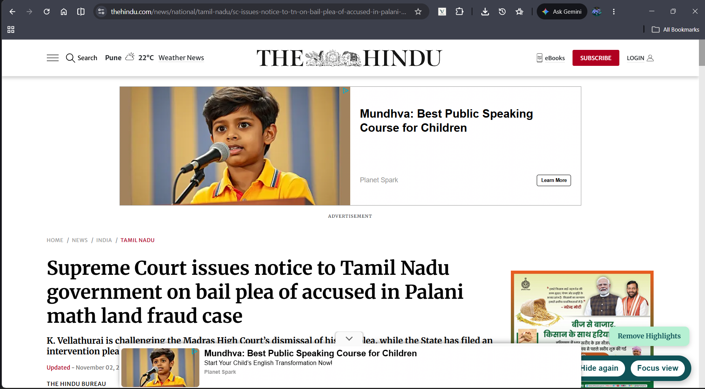
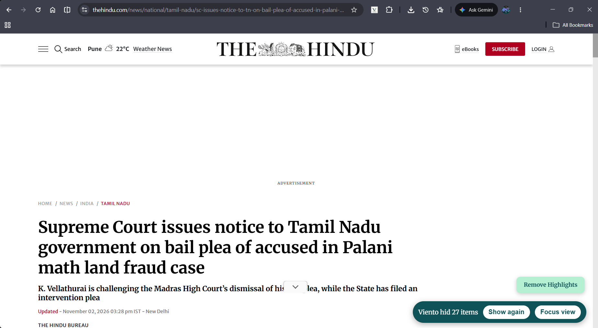
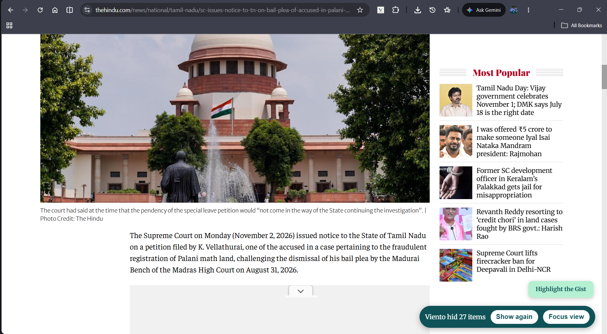
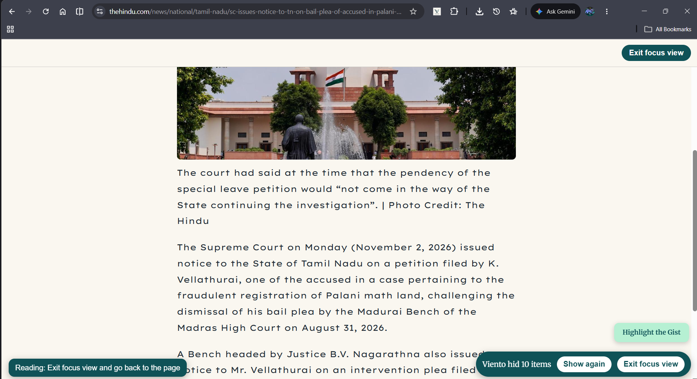
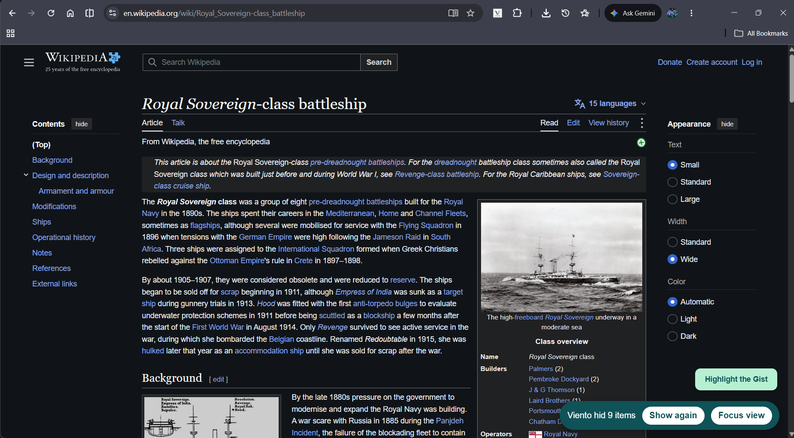
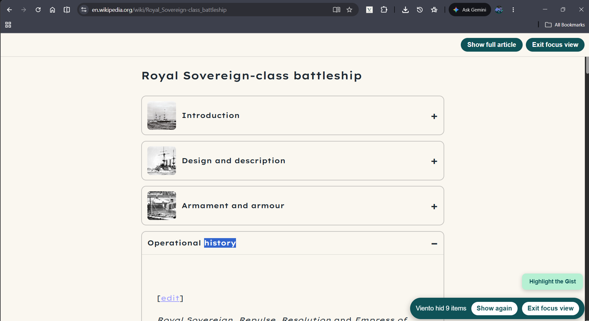
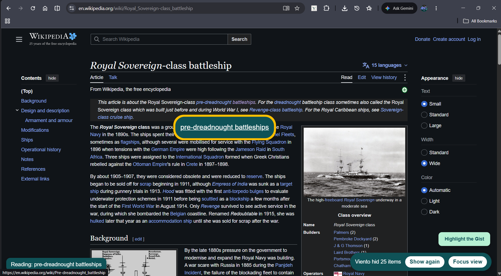
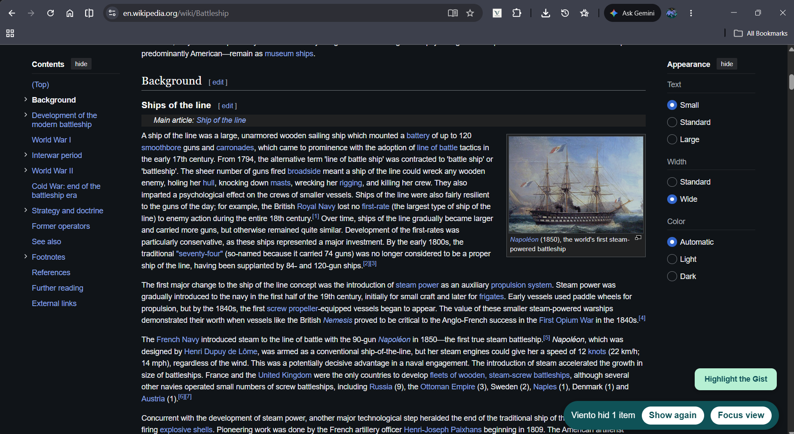
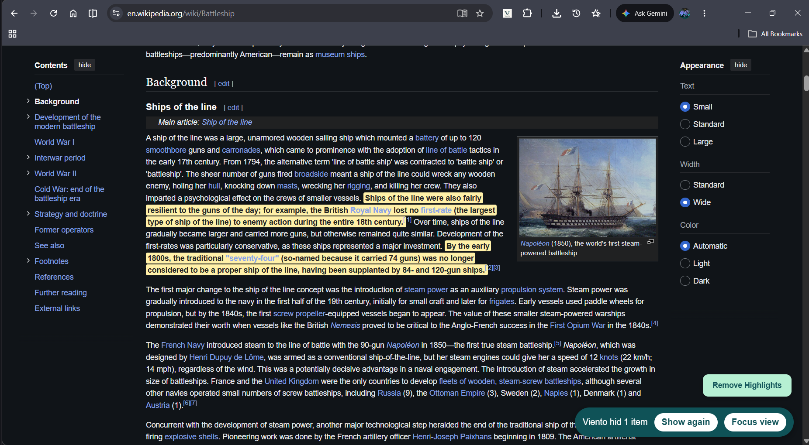

#  Viento
 
Providing a calmer browsing experience for neurodivergent minds

It has three parts that work together:

- **Calm mode** 
- **Hover mode** 
- **Gist mode** 

## Contents

- [How Viento addresses the challenge](#how-viento-addresses-the-challenge)
- [Install](#install)
- [Calm mode](#calm-mode) · [Hover mode](#hover-mode) · [Gist mode](#gist-mode)
- [Browser support](#browser-support)
- [Security and privacy](#security-and-privacy)
- [Future improvements](#future-improvements)
- [Team](#team)
- [Credits and license](#credits-and-license)

  
## How Viento addresses the challenge

| Barrier | What gets in the way | How Viento helps |
|---|---|---|
| **Disabilities** (low vision, dyslexia, ADHD, autism) | Clutter, dense text, tiny click targets, sensory overload | Calm mode removes distractions, Focus view shows only the article, Hover mode enlarges what you point at, and Gist mode marks key sentences |
| **Limited technical literacy** | Confusing pages, unclear buttons, settings to learn | Nothing to configure, one click for Focus view, a bar that tells you what was hidden and lets you undo it, and labels spoken aloud |

## Install

1. Download the latest zip from the [Releases](../../releases) page, or click
   **Code > Download ZIP** on this page. Unzip it.
2. In Chrome, open `chrome://extensions`.
3. Turn on **Developer mode** (top right).
4. Click **Load unpacked** and choose the folder that contains `manifest.json`.
5. Refresh any pages that were already open.

**To check it works:** open a Wikipedia article. A small bar should appear in the
bottom-right corner, and moving your mouse over a link should enlarge it.

## Browser support
Viento currently only supports google chrome.

## Calm mode

Provides an easier and more focused browsing experience for neurodivergent minds(ADHD, Autism, dyslexia, etc.).

### What it does
  

- **Hides clutter:** cookie banners, newsletter pop-ups and common ad containers
  are hidden. Items that load late are caught too.
  | Before | After |
  |---|---|
  |  |  |
- **"What I hid" bar:** a small bar in the bottom-right corner shows how many
  items were hidden. **Show again** brings them back, and **Hide again** removes
  them again. Nothing is ever deleted from the page.
- **Focus View**
1. **Focus view:** on article pages, one click opens a clean reading page with
  only the article. Click the button again (or press **Esc**) to return to the
  original page.

  | Before | After |
  |---|---|
  |  |  |
2. **Outline view:** if the article has enough headings, Focus view shows one
  card per section, with a thumbnail and heading. Click a card to open only that
  section. **Show full article** switches to the whole text.
  
  | Before | After |
  |---|---|
  |  |  |

### How to use it

1. Open any website with the extension installed.
2. If anything was hidden, the bar appears in the bottom-right corner.
3. On an article page, click **Focus view**. Click **Exit focus view** to leave.

### How it works

| Part | File | What it does |
|---|---|---|
| Clutter hiding and bar | `calm.js`, `calm.css` | Finds clutter using a list of selectors, hides it with a CSS class, and watches the page for new items |
| Focus view | `focus.js` | Extracts the article, cleans it, and shows it in an isolated overlay (Shadow DOM) |
| Article extraction | `Readability.js`, `Readability-readerable.js` | Third-party library (see below) |

### Known limitations

- Works best on **article-style pages with clear headings**, such as Wikipedia,
  blogs and explainers.
- Focus view does not work on every site. eg., Times of India, Economic Times.
- Ad and clutter detection uses a short list of rules, so it won't catch every
  ad. It is not an ad blocker.
- Outline view needs at least three sections. Otherwise, the full article is shown.

### Tested on

| Site | Hide clutter | Focus view | Outline view |
|---|---|---|---|
| Wikipedia article | 👍 | 👍 | 👍 |
| The Hindu | 👍 | 👍  | - |
| Times of India | 👍 | 👎 | 👎 |
| Economic Times | 👍 | 👎 | 👎 |

## Hover mode

Makes links and buttons easier to see and hear, for people with low vision, limited hand control, or who find it easier to listen than to read.

### What it does
| Before | After |
|---|---|
|  |  |

- **Enlarges what you point at:** the link or button under the mouse grows by half and gets a solid teal background, white text and a yellow border. It is easy to read on light and dark pages, and it covers whatever is behind it. It shrinks back when the mouse leaves.
- **Reads it aloud:** after the mouse rests on a link or button for a moment, its label is spoken. Moving away stops the voice, so voices never overlap. Icon-only buttons with no text are read from their hidden label (`aria-label`, image `alt`, or icon title). If there is none, Viento says "button" or "link".
- **Shows a caption:** the words being read also appear in the bottom-left corner, so you can see what Viento is saying.

### How to use it

1. Open any website with the extension installed.
2. Move the mouse over a link or button and hold it still for about a second.
3. The item enlarges, its label is read aloud, and the caption appears.
4. Move the mouse away to stop.

### How it works

| Part | File | What it does |
|---|---|---|
| Hover, label and caption logic | `hover.js` | Watches the mouse, works out the label, enlarges the item and asks for speech |
| Voice | `background.js` | Speaks the label using Chrome's built-in text-to-speech |
| Enlarge and highlight styles | `hover.css` | The teal background, yellow border and grow effect |

If Chrome's extension voice fails, `hover.js` falls back to the page's built-in speech and shows a short message in the corner explaining any problem.

### Tested on

| Site | Enlarge | Read aloud |
|---|---|---|
| Wikipedia article | 👍 | 👍 |
| The Hindu | 👍 | 👍 |
| Times of India | 👍 | 👍 |

### Known limitations

- Very large links (full-width cards and banners) get a border but are not enlarged, and neither are links that wrap over several lines. This stops the page layout from jumping.
- The backup voice (the page's built-in speech) only works after you have clicked or typed on the page once. The main voice does not have this rule.
- Speech language depends on the voices installed in the browser or operating system.
- Settings such as on/off, voice speed and language are not in a popup yet.

# Gist Mode

Automatically highlights the most important sentences on a webpage, helping users understand lengthy content quickly and focus on the key information.

## Gist Mode Features
| Before | After |
|---|---|
|  |  |

- **Automatic Highlighting:** Important sentences are highlighted automatically when a webpage loads. No manual button or user interaction is required.
- **Important Information Detection:** Identifies meaningful sentences using rule-based scoring techniques.
- **Keyword Recognition:** Detects sentences containing important terms, definitions, conclusions, causes, effects, advantages, disadvantages, problems, and solutions.
- **Number and Date Recognition:** Gives additional importance to sentences containing numbers, percentages, dates, and other useful information.
- **Context-Based Scoring:** Considers sentence length, repeated topic words, and the position of sentences within paragraphs to identify potentially important information.
- **Wikipedia Support:** Works on Wikipedia pages and allows important sentences containing hyperlinks to be highlighted.

## How to Use

1. Open any supported webpage.
2. Gist Mode automatically scans the available paragraph content.
3. Important sentences are identified using the scoring system.
4. Selected sentences are highlighted with a soft yellow background.
5. Read the highlighted sentences to quickly understand the main points of the webpage.

## How It Works

| Component | Function |
|---|---|
| `gist.js` | Extracts paragraphs, splits them into sentences, scores their importance, and applies highlights. |
| `gist.css` | Defines the appearance of highlighted sentences. |
| `MutationObserver` | Detects dynamic changes in webpage content. |
| Rule-Based Scoring | Assigns importance scores using keywords, sentence structure, numbers, and context. |
| `TreeWalker` and `Range` | Locate sentence text and wrap selected text with highlight elements. |

### Tested on

| Site | Highlight the gist |
|---|---|
| Wikipedia article | 👍 |
| The Hindu | 👍 |
| Times of India | 👎 |

## Known Limitations

- Gist Mode uses rule-based scoring rather than advanced AI-based understanding.
- Its keyword-based rules work best with English-language content.
- It mainly processes paragraph-based webpage content.
- Very short paragraphs and certain webpage elements are skipped.
- Results may vary depending on the structure and layout of a webpage.
- Dynamic content may take a short time to be detected and highlighted.

# Security and Privacy

Viento runs entirely in your browser. It collects no data, needs no account, and sends nothing to any server, though, some system or browser voices may process speech online. Choose an offline voice if this matters. All scripts and fonts are bundled inside the extension.

- **Calm mode** and **Focus view** process page content locally.
- **Hover read-aloud** uses your browser's text-to-speech voices.
- **Highlight the gist** uses a built-in rules and makes no network requests.
- Pages with password fields are left untouched for calm mode only, and hidden items can always be restored.
  
# Future Improvements

### Calm mode
- Improve content detection on websites with complex layouts, and support sites where Focus view currently fails.
- Expand the clutter rules, and let users choose how much is hidden (light, medium, strong).
- Let users add or remove sites from a personal "never touch" list.
- Remember each user's choices between pages and browser sessions.
- Add reading controls to Focus view, such as text size, spacing, and colour themes.
- Improve outline view by grouping short sections and choosing better thumbnails.

### Hover and read aloud
- Describe icon-only buttons in plain words (for example, "Search" or "Menu").
- Add a short "what will this do?" explanation before risky actions such as paying or deleting.
- Improve voice quality and language selection, with better Hindi and regional-language support.
- Let users adjust zoom size, delay, and speech speed.

### Gist highlighting
- Integrate AI-based sentence understanding for more accurate highlighting.
- Add customisable highlighting levels.
- Support more languages.
- Work inside Focus view and on pages that load content dynamically.

### Across the whole project

- Test with more users, including people with dyslexia, ADHD, autism, and older adults, and improve the design from their feedback.
- Add warnings for suspicious pages, to help people with limited technical literacy avoid scams.
- Improve compatibility with different browsing modes and dynamically loaded content.

## Team

| Name | Role |
|---|---|
| Anvay Dhaske | Calm mode (clutter hiding, Focus view, outline view) |
| Tanmay Tugnawat | Hover mode (enlarge and read aloud) |
| Pritesh Jaiswal and Hans Biswas | Gist mode (sentence highlighting) |
| Anvay and Tanmay | Testing, README, demo video |

## Credits and license

- **Mozilla Readability** finds the article in Focus view
  ([Apache License 2.0](https://github.com/mozilla/readability)). Its notice is
  kept at the top of the library files.
- **Lexend Exa and Lexend Giga** fonts are used in Focus view
  ([SIL Open Font License](calm/fonts/OFL.txt)). [Keep only if the fonts are in
  the final build.]
- Viento is released under the [MIT License](LICENSE).
